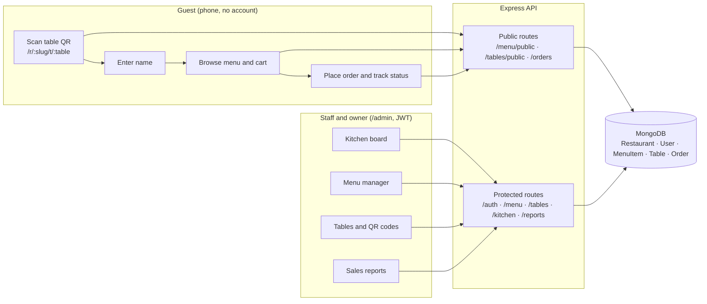
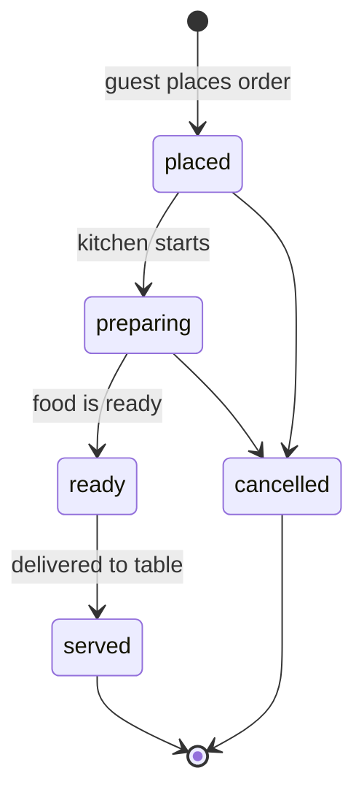
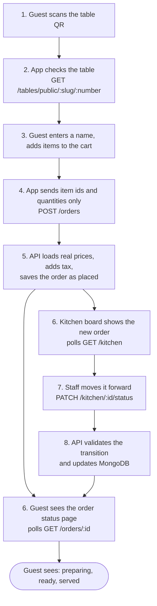

# TableTap

**QR-based restaurant ordering.** Guests scan the QR code on their table, enter a name, browse the menu and order, with no sign-up and no app install. Staff see orders arrive on a live kitchen board; owners manage the menu, tables and QR codes and track sales.

IT645 MERN course project. Team: Durgesh, Moksh.

---

## Features

**For guests (no account)**
- Scan a table QR code, which opens `/r/<restaurant>/t/<table>`; the table is verified, then the guest enters a name.
- Browse the menu by category, with veg / non-veg tags and special-request notes per item.
- Cart and one-tap checkout. Prices are calculated on the server (including tax), so they can't be tampered with.
- Live order tracking: received, preparing, ready, served.

**For restaurant staff and owners**
- JWT login, with owner and staff roles. Owners can add staff accounts.
- **Kitchen board:** new / preparing / ready columns that refresh automatically. Status changes are validated (an order can't skip steps), and orders can be cancelled before they're ready.
- **Menu management:** add, edit, hide and delete items.
- **Tables and QR codes:** create tables, preview the QR code, download it as a PNG for printing.
- **Sales reports:** revenue, order count, average order value, top-selling items and daily totals, with a date filter. Cancelled orders are excluded.

**Platform**
- Multi-tenant: every record belongs to a restaurant, and one restaurant can never read or change another's data.
- Rate limiting on login/registration and on guest order creation, plus helmet, CORS and a request-size cap.

## Tech stack

| Layer | Tools |
|-------|-------|
| Frontend | React 18, Vite, React Router, Axios |
| Backend | Node.js, Express, Mongoose |
| Database | MongoDB |
| Auth | JWT (Bearer tokens), bcrypt password hashing |
| Other | `qrcode` for QR generation, `express-rate-limit`, `helmet` |
| Testing | `node:test` and `supertest` (API), Postman collections |

## How it works



### Order lifecycle



### One order, end to end



## Project structure

```
server/                 Express API
  src/
    app.js              middleware and route mounting
    config/             env + database connection
    middleware/         auth (protect, restrictTo), errors, asyncHandler
    models/             Mongoose schemas (Restaurant, User, MenuItem, Table, Order)
    modules/            one folder per feature: routes + controller
      auth/ menu/ tables/ orders/ kitchen/ reports/
    seed.js             demo data
  test/api.test.js      end-to-end API tests
client/                 React web app
  src/
    pages/admin/        Login, Dashboard, Kitchen, MenuManager, Tables, Reports
    pages/guest/        GuestEntry, GuestMenu, GuestOrder
    context/ api/ components/
docs/                   API reference, architecture, testing guide
postman/                one collection per module + shared environment
mobile/                 React Native placeholder (not started)
```

## Getting started

**Prerequisites:** Node.js 18+ and a MongoDB instance. The quickest way to get one is Docker: `docker compose up -d`.

```bash
# 1. Backend
cd server
cp .env.example .env        # adjust MONGO_URI / JWT_SECRET if needed
npm install
npm run seed                # optional demo data (see below)
npm run dev                 # API on http://localhost:5000  (health: /api/health)

# 2. Frontend (new terminal)
cd client
npm install
npm run dev                 # app on http://localhost:5173
```

### Try the demo
After `npm run seed`:

| What | Where |
|------|-------|
| Guest ordering (table 1) | http://localhost:5173/r/demo-diner/t/1 |
| Admin login | http://localhost:5173/admin/login |
| Owner account | `owner@demo.com` / `demo1234` |
| Staff account | `staff@demo.com` / `demo1234` |

Open the guest link in one window, place an order, then watch it appear on the kitchen board in the admin window. Demo credentials are for local development only; `npm run seed` wipes the database it points at.

### Environment variables

| Variable | Default | Purpose |
|----------|---------|---------|
| `PORT` | `5000` | API port |
| `MONGO_URI` | `mongodb://127.0.0.1:27017/tabletap` | MongoDB connection string |
| `JWT_SECRET` | `dev-secret` | **Required in production** (the server refuses to start without it) |
| `JWT_EXPIRES_IN` | `7d` | Token lifetime |
| `CLIENT_URL` | `http://localhost:5173` | Allowed CORS origin; also the base of generated QR URLs |
| `VITE_API_URL` (client) | `/api` | API base URL; in dev Vite proxies `/api` to port 5000 |

## API overview

| Area | Endpoints |
|------|-----------|
| Auth | `POST /auth/register`, `POST /auth/login`, `GET /auth/me`, `POST /auth/staff` |
| Menu | `GET /menu/public/:slug`, `GET/POST /menu`, `PUT/DELETE /menu/:id` |
| Tables | `GET /tables/public/:slug/:number`, `GET/POST /tables`, `PUT/DELETE /tables/:id`, `GET /tables/:id/qr` |
| Orders (guest) | `POST /orders`, `GET /orders/:id` |
| Kitchen | `GET /kitchen`, `PATCH /kitchen/:id/status` |
| Reports | `GET /reports/summary?from=&to=` |

Full request/response notes, access rules and rate limits: [docs/api.md](docs/api.md).

## Testing

```bash
cd server
TEST_MONGO_URI=mongodb://127.0.0.1:27018/tabletap_test npm test
```

The suite has 11 end-to-end tests covering auth and roles, menu, tables and QR codes, server-side pricing, kitchen status rules, report maths and tenant isolation. It drops its database before and after, so point it at a throwaway database. Without `TEST_MONGO_URI` it downloads an in-memory MongoDB (large first download). Details, Postman usage and a manual smoke-test checklist: [docs/testing.md](docs/testing.md).

## Roadmap
- [ ] React Native app for the QR deep link (`tabletap://r/<slug>/t/<table>`), falling back to the website
- [ ] AI ordering assistant exposed as an MCP server
- [ ] Websocket updates instead of polling for the kitchen board and order status
- [ ] Payment integration and printable table-tent PDFs

## Documentation
- [API reference](docs/api.md)
- [Architecture notes](docs/architecture.md)
- [Testing guide](docs/testing.md)
- [Postman collections](postman/README.md)

## Team and ownership

| Area | Owner |
|------|-------|
| Restaurant management: owner/staff auth, menu, tables + QR codes, kitchen board, sales reports | Durgesh |
| Guest ordering | Moksh |
| Shared: Express middleware, MongoDB schemas, deployment | Both |
